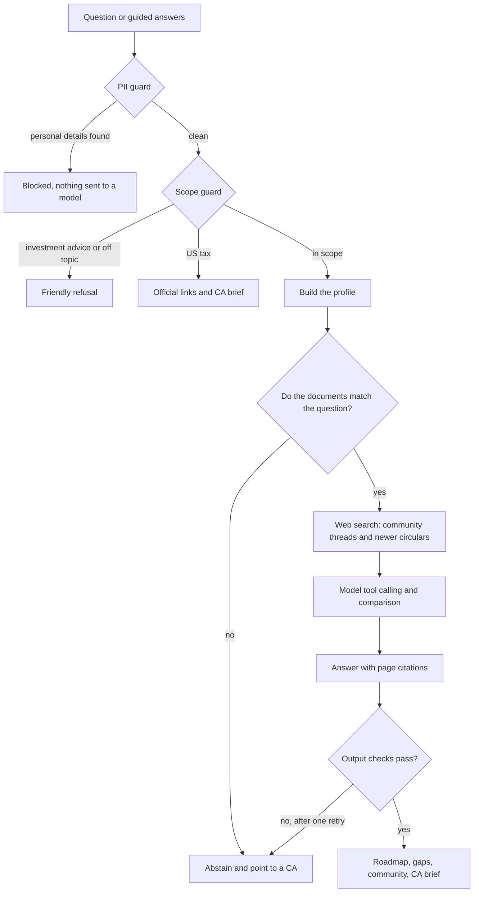
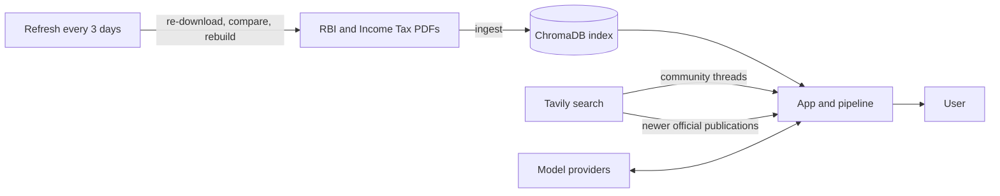

# NRI Return Copilot

An assistant that shows returning NRIs which Indian rules and paperwork apply to their situation. Answers come from official RBI and Income Tax documents, and every statement links to the exact page it came from. Community discussion is shown separately and marked as unofficial.

**Demo video (about 2 minutes):** [Watch on Loom](https://www.loom.com/share/2c80eb01aa0f482a9f9f385cfb9a2e17)

**Live app:** [nri-return-copilot.streamlit.app](https://nri-return-copilot.streamlit.app/)

> **Note:** the first load can take a minute or two. The app is hosted on Streamlit's free Community Cloud, which puts apps to sleep after a period of no visitors, and it has to start up again when someone opens it. Once it is awake, pages respond normally. The video above is the quickest way to see how it works.

## Overview

NRIs moving money and assets back to India (a US 401(k), investments from Canada, Australia or New Zealand, an entire portfolio) deal with RBI, FEMA and Income Tax rules that are spread across long documents written for specialists. Forum threads fill the gap, but they can be wrong or out of date.

NRI Return Copilot builds a profile from a short intake, searches the official documents for what applies, and returns a roadmap with sources. It explains rules. It does not recommend investments or answer US tax questions.

**Scope:** residential status on return, NRE and NRO accounts, foreign shares, RSUs and funds, foreign retirement accounts such as a 401(k) (India-side treatment only), and reporting foreign assets in the Indian tax return. The country being moved from does not matter, since answers come from Indian rules.

## Features

- **Two ways in.** A guided intake of nine questions, or a free-text question. Every multiple-choice question has a box for anything the options do not cover, and what is written there is interpreted and used.
- **Common questions.** A sidebar lists 20 questions that returning NRIs ask. Each answer is written from the official documents and shows the exact quote, the document, the authority that issued it, its release date and the page. Answers open at once and use no model calls. Each question has a prepared search for community discussions, run live and shared for a day. Answers are ignored automatically once any document changes.
- **Cited roadmap.** Each step shows the document, its release date (where known) and the page, with links to that page and the full document.
- **Newer circulars.** A search of the RBI and Income Tax sites flags publications dated after the last document update.
- **Community tier.** Linked Reddit, X and Quora threads, each labelled as agreeing with, contradicting or unrelated to the official text.
- **Gaps listed.** Facts that could not be determined are listed, with how each would change the answer.
- **Abstention and escalation.** When the documents do not support an answer, the assistant says so, refers the user to a chartered accountant (CA) and lists community discussions to read. Complex cases produce a downloadable CA brief that contains no personal details.
- **India side first.** A question with a foreign-country side, such as moving a US 401(k) to India, is answered for what the Indian documents cover. The foreign part is flagged for a local tax professional, with official links.

## How it works

Requests move through a fixed sequence of steps. It is a pipeline with model tool calling, not an autonomous agent. A request can stop early at four points: the PII guard, the scope guard, the document search and the output checks.



1. **PII guard.** Pattern matching blocks phone numbers, PAN, Aadhaar-style numbers, emails, card numbers and account-like numbers before any model call.
2. **Scope guard.** Investment advice and off-topic requests are declined. Questions about US tax alone get official links and community discussions. Mixed questions continue with the US part flagged.
3. **Profile.** Built from the form or extracted from free text. Fields that are not stated stay empty.
4. **Document search.** ChromaDB finds passages. If the user's question has no good match, the assistant abstains.
5. **Web search.** Tavily finds community threads, and newer publications on the RBI and Income Tax sites.
6. **Tool calling.** The model can call official search, a days-in-India calculator (adds days only, never decides status) and community search.
7. **Comparison.** Each thread and new publication is checked against the official text.
8. **Answer.** The model cites passages by number and code builds the real citations, so a document or page cannot be invented.
9. **Output checks.** Every item is cited, the disclaimer is present, advice language and usernames are absent, and missing facts are listed. One retry, then abstain.
10. **Review flag and CA brief** for complex cases.

### Data flow



Rules come only from the official PDFs. Web results are shown separately and never mixed into the official answer.

## Tech stack

Python, LangChain, ChromaDB, Tavily (web search), Scrapy (open-source crawler for the document refresh), Streamlit, Pydantic, pandas, pytest. Embeddings run locally with `all-MiniLM-L6-v2`. Language models are accessed through interchangeable providers (Groq, Gemini, OpenRouter, Cerebras, Mistral).

## Getting started

### Prerequisites

Python 3.12 or newer, and an API key for at least one language model provider.

### Installation

```bash
python -m venv .venv
source .venv/bin/activate         # Windows: .venv\Scripts\activate
pip install -r requirements.txt
cp .env.example .env              # Windows: copy .env.example .env
python scripts/ingest.py          # builds the search index from data/official/
```

### Configuration

Settings are read from environment variables, loaded from `.env` locally.

| Variable | Required | Purpose |
|---|---|---|
| `GROQ_API_KEY`, `GEMINI_API_KEY`, `OPENROUTER_API_KEY`, `CEREBRAS_API_KEY`, `MISTRAL_API_KEY` | At least one | Language model providers |
| `TAVILY_API_KEY` | Optional | Community search and the newer-publication check |
| `LLM_PROVIDER_ORDER` | Optional | Provider order, default `groq,gemini,cerebras,openrouter,mistral` |
| `GROQ_MODEL`, `GEMINI_MODEL`, `OPENROUTER_MODEL`, ... | Optional | Override a provider's main model |
| `GROQ_FAST_MODEL`, `GEMINI_FAST_MODEL` | Optional | Override a provider's faster model for the small steps |

Providers are tried in order. A provider without a key is skipped, and a rate-limited or failing provider hands over to the next. Each provider has a main model for writing the answer and a faster one for the small steps, with separate daily quotas on most free tiers. Either one covers for the other when its quota runs out. `python scripts/check_llm.py` tests each configured provider for plain replies, structured output and tool calling.

Keys come from [Groq](https://console.groq.com/keys), [Google AI Studio](https://aistudio.google.com/apikey), [OpenRouter](https://openrouter.ai/keys), [Cerebras](https://cloud.cerebras.ai), [Mistral](https://console.mistral.ai) and [Tavily](https://app.tavily.com).

### Run

```bash
streamlit run app.py
```

## Usage

- **Common questions:** select one in the sidebar for an immediate answer.
- **Guided:** answer the questions one at a time, then select "Get my roadmap".
- **Ask directly:** type a question, for example "What happens to my NRO account when I return to India for good?"
- **Community threads:** can be switched off with the checkbox above the question.

Results have four parts: the roadmap, what could not be determined, community experience, and the CA brief.
## Deployment

The app runs on Streamlit Community Cloud and Hugging Face Spaces. Connect the repository, use `app.py` as the entry point and add the variables from the Configuration table as secrets. The search index is built automatically on first start.

## Security and privacy

- Personal identifiers are blocked before any model call, and user input is not stored.
- Logs record step names and outcomes, never the text as typed.
- Community results keep only a link, title, snippet, date and site, with usernames and identifiers removed.

## Project structure

```
app.py          Streamlit app
config.py       settings and thresholds
copilot/        pipeline, retrieval, tools, prompts, model calls
guardrails/     PII, scope, grounding, escalation, output checks
scripts/        ingest, refresh, build_prepared_answers, check_llm, score_report
analytics/      community thread collection, tagging and charts
evals/          golden set, runner, tuning
data/official/  source PDFs and manifest.csv
tests/          unit and workflow tests
```

## Testing and evaluation

```bash
pytest                      # models are faked, no keys needed
python evals/run_evals.py   # 30-question golden set, writes evals/results.md
python evals/tune.py        # chunk size and abstention threshold comparison, no key needed
```

The evaluation reports retrieval hit rate, unsupported-claim rate, refusal accuracy and PII catch rate, along with missing-information handling, citation completeness, escalation precision and recall, and contradiction detection. Metrics that need a model are marked `NOT RUN` when no key is configured.

## Keeping documents current

`python scripts/refresh.py` re-downloads every document in `data/official/manifest.csv`, compares SHA-256 hashes, archives changed files and rebuilds the index. A failed download never removes the existing file. A GitHub Action runs the refresh every three days.

`python scripts/build_prepared_answers.py` rebuilds the common-question answers from `data/curated_answers.json`. It checks that every quote is on its page of the downloaded PDF and stops at any quote it cannot find, so run it after a refresh.

Downloads use a Scrapy crawler (`scripts/crawler.py`) that identifies itself as `NRIReturnCopilot-refresh`, obeys `robots.txt`, makes one request at a time per site with a delay, and retries transient errors. Only responses that are PDFs are accepted.

## Limitations

- Answers cover the documents in `data/official/`. The set is still growing and does not yet include documents on 401(k) or RSU treatment, so those questions often end in a referral to a CA.
- The newer-publication check flags items published after the last update. It does not add them to the answer.
- Community threads are personal experiences from a biased sample, and are not authoritative.
- Text is sent to the configured model provider. The tool is not intended for sensitive casework.
- Availability and answer quality depend on the model providers in use.

## Disclaimer

General information drawn from official documents. It is not legal, tax or investment advice. Confirm with a qualified chartered accountant before acting.
